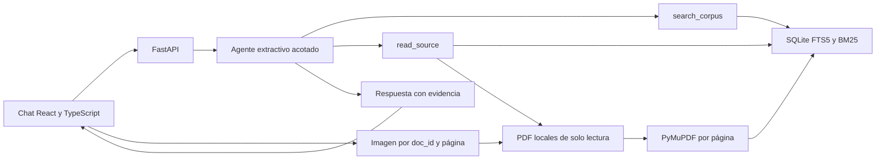

# Archivo financiero · RAG documental P0

Aplicación local para consultar reportes PDF y abrir la página que respalda una respuesta. El agente extractivo de este corte consulta el índice, lee fragmentos y selecciona una cita verificable. Devuelve texto del documento y declara evidencia insuficiente si la consulta carece de respaldo. Los documentos y las preguntas se procesan localmente.

## Arranque en desarrollo

Requisitos: Python 3.11 o superior con SQLite FTS5, uv, Node 22.12+ y npm. En la revisión del P0 se usaron Python 3.12 y Node 24. Desde la raíz:

```bash
uv sync --locked
npm ci --prefix apps/web
export RAG_DATA_DIR="$HOME/data"
export RAG_STATE_DIR="$HOME/.local/share/p2banorte"
uv run --locked python -m apps.api.corpus --limit 2
uv run --locked uvicorn apps.api.main:app --host 127.0.0.1 --port 8000
```

En el ensayo local con la entrega privada, selecciona `RAG_DATA_DIR="$PWD/docs/requirements/data"` y un `RAG_STATE_DIR` propio para ese corpus antes de indexar y arrancar la API. En un checkout público puedes usar una carpeta propia con PDF autorizados y texto seleccionable. En Coder se utiliza el corpus suministrado en `~/data`. El índice y los originales deben estar separados. El índice conserva la identidad de su raíz de datos.

En una segunda terminal:

```bash
npm --prefix apps/web run dev -- --port 5173
```

Abre **http://127.0.0.1:5173**. El servidor Vite envía `/api` al backend en el puerto 8000. Para otro puerto configura `RESOURCE_BASE_URL` en la terminal de Vite. La API publica su contrato en `http://127.0.0.1:8000/docs`.

## Comprobación manual

1. Comprueba que la biblioteca muestra los documentos indexados. Formula una pregunta sobre un concepto que hayas comprobado en una página concreta de un PDF.
2. Abre la cita y compara la imagen con esa misma página en tu lector de PDF. Cierra con Escape para volver a la cita.
3. Pregunta por un tema ajeno al corpus. La respuesta debe informar evidencia insuficiente.
4. Repite la ingesta con los mismos parámetros. El resumen de consola informa documentos reutilizados, nuevos y fallidos. `--limit 2` selecciona los dos PDF más pequeños para el primer corte. `--all` indexa todos los PDF elegibles. Cada ejecución publica atómicamente el conjunto seleccionado y conserva el índice anterior si se interrumpe antes del commit.

## Arquitectura V3



`GET /api/health` informa salud, modo y cantidad de documentos. `GET /api/documents` enumera el catálogo. `POST /api/chat` recibe `{"message":"…"}` y devuelve respuesta, citas, herramientas y modo de proveedor. `GET /api/documents/{doc_id}/pages/{pdf_page}/image` renderiza una página desde 1 y comprueba el hash del original. Los tamaños y el DPI de salida están limitados.

El P0 ofrece recuperación léxica y respuestas extractivas. En el entorno verificado `LLM_PROVIDER=extractive` es el modo predeterminado. La integración con inferencia generativa requiere un proveedor autorizado y su contrato. El presupuesto del agente limita llamadas y tiempo, y una configuración de proveedor indisponible produce un error recuperable. Comparación contable, cálculo con Decimal, tablas bajo demanda y evaluación de todo el corpus corresponden a etapas posteriores de V3.

## Pruebas

```bash
uv run --locked python -B -m pytest -q tests/p0 tests/harness
npm --prefix apps/web run build
cd apps/web
npx playwright install chromium
npm run smoke
```

La prueba de navegador levanta sus propios servidores de loopback en 8179 y 5179, genera un PDF ficticio en un directorio temporal y usa el Python de `.venv`. Puede usarse un Chromium preinstalado definiendo `PLAYWRIGHT_CHROMIUM_EXECUTABLE`. El smoke cubre cinco anchos de pantalla, foco, página original, abstención y recuperación de errores.

La evaluación con documentos reales y el estado de cada tarea se conservan en la [bitácora](docs/execution/EXECUTION_LOG.md) y en el [sprint P0](docs/execution/SPRINTS.md).

## Demo de comparación financiera local

En el modo `financial-local`, las consultas documentales usan P0. Las peticiones explícitas de comparación o cálculo usan un doble determinista, la calculadora Decimal y las herramientas V3 sobre el mismo índice. Para una demostración reproducible en otra carpeta, detén la API anterior y ejecuta:

```bash
demo_dir=$(mktemp -d)
export RAG_DATA_DIR="$demo_dir/pdf"
export RAG_STATE_DIR="$demo_dir/state"
export LLM_PROVIDER=financial-local
uv run --locked python tests/financial/fixtures.py "$RAG_DATA_DIR"
uv run --locked python -m apps.api.corpus --all
uv run --locked uvicorn apps.api.main:app --host 127.0.0.1 --port 8000
```

Con el frontend de desarrollo en marcha, prueba estas preguntas:

- **Compara la utilidad neta de Grupo Faro entre 3T24 y 3T25.** La diferencia es 12.29 millones MXN y cada cita abre la página 2 de su propio PDF.
- **Calcula la variación porcentual de la utilidad neta de Grupo Faro entre 3T24 y 3T25.** La variación es 11.06 %.
- **Compara la utilidad neta de Grupo Faro entre 3T24 y 9M25.** El agente identifica la diferencia de duración o tipo y omite el cálculo.

El corte busca etiquetas trimestrales como `3T25` y acumuladas como `9M25`. El primer periodo indicado es la base de cálculo. Prioriza tablas con rótulos verificables de indicador, periodo, entidad, consolidación y unidad. Ante encabezados ambiguos o evidencia insuficiente se abstiene. Para volver a P0, inicia con `LLM_PROVIDER=extractive` y sus rutas habituales. La evidencia de AC-06 se registra por separado en el modo DeepSeek con datos ficticios.

Pruebas dirigidas: `uv run --locked python -B -m pytest -q tests/financial tests/p0`.

### Recuperar la demo con un índice existente

Desde la raíz, configura las rutas del corpus y de su índice SQLite existente. En el ensayo de los 24 PDF, la raíz de datos es `$PWD/docs/requirements/data`. En Linux con systemd de usuario, ejecuta lo siguiente con ambos puertos libres y las dependencias instaladas.

~~~bash
: "${RAG_DATA_DIR:?Configura la ruta absoluta de los PDF}"
: "${RAG_STATE_DIR:?Configura la ruta absoluta del índice existente}"
test -f "$RAG_STATE_DIR/corpus.sqlite3" &&
systemd-run --user --unit=p2banorte-api --collect --property="WorkingDirectory=$PWD" \
  --setenv=LLM_PROVIDER=financial-local --setenv="RAG_DATA_DIR=$RAG_DATA_DIR" \
  --setenv="RAG_STATE_DIR=$RAG_STATE_DIR" \
  "$PWD/.venv/bin/python" -B -m uvicorn apps.api.main:app --host 127.0.0.1 --port 8194
systemd-run --user --unit=p2banorte-web --collect --property="WorkingDirectory=$PWD" \
  --setenv=RESOURCE_BASE_URL=http://127.0.0.1:8194 \
  "$(command -v node)" "$PWD/apps/web/node_modules/vite/bin/vite.js" \
  apps/web --host 127.0.0.1 --port 5194 --strictPort
curl -fsS http://127.0.0.1:8194/api/health
~~~

Abre http://127.0.0.1:5194. Los dos servicios se pueden reiniciar por separado con `systemctl --user restart` seguido del nombre de la unidad. Para detener ambos, ejecuta `systemctl --user stop p2banorte-web.service p2banorte-api.service`. El arranque abre el índice existente directamente.

## Rescate determinista en la demo web

Deja Vite en 5194. La API usa el mismo puerto 8194 en ambos modos y abre el SQLite existente. Desde la raíz del repositorio, ejecuta este bloque con las rutas de la demo de 24 PDF.

~~~bash
export RAG_DATA_DIR="$PWD/docs/requirements/data"
export RAG_STATE_DIR=/tmp/p2-slice002.w2abwN02/corpus-eval
P2BANORTE_LOCAL_MODE=hybrid-experimental
(
  set -e
  case "$P2BANORTE_LOCAL_MODE" in hybrid-experimental|financial-local) ;; *) exit 2 ;; esac
  test -f "$RAG_STATE_DIR/corpus.sqlite3"
  if systemctl --user is-active --quiet p2banorte-api.service; then
    systemctl --user stop p2banorte-api.service
  fi
  for intento in $(seq 1 20); do
    estado=$(systemctl --user show p2banorte-api.service -p LoadState --value 2>/dev/null || true)
    if [ -z "$estado" ] || [ "$estado" = not-found ]; then break; fi
    sleep 1
  done
  systemd-run --user --unit=p2banorte-api --collect --property="WorkingDirectory=$PWD" \
    --setenv="LLM_PROVIDER=$P2BANORTE_LOCAL_MODE" --setenv="RAG_DATA_DIR=$RAG_DATA_DIR" \
    --setenv="RAG_STATE_DIR=$RAG_STATE_DIR" --setenv=HYBRID_DEEPSEEK_SCOPE=blocked \
    --setenv=DEEPSEEK_ALLOW_REAL_DATA=false --setenv=DEEPSEEK_SYNTHETIC=false \
    "$PWD/.venv/bin/python" -B -m uvicorn apps.api.main:app --host 127.0.0.1 --port 8194
)
curl --retry 8 --retry-connrefused --retry-delay 1 -fsS http://127.0.0.1:5194/api/health
~~~

En el híbrido, salud informa `planner=deterministic` y `external_data_scope=blocked`. Las cabeceras `X-Hybrid-*` registran la activación, los apartados intentados y acreditados, el tiempo y el desenlace. La bitácora `journalctl --user -u p2banorte-api.service` registra esos datos por ID de solicitud. Para volver al modo anterior, repite el bloque con `P2BANORTE_LOCAL_MODE=financial-local`. Si Vite está detenido, inícialo con el comando de la sección anterior.

## DeepSeek en una instancia sintética aislada

FastAPI usa DeepSeek Flash con el contrato Chat Completions, cinco funciones V3 y thinking desactivado. El modelo selecciona identificadores temporales de bloques. El backend valida referencias y comparabilidad, ejecuta Decimal y compone el texto a partir de resultados observados. El visor PNG sigue siendo local y la herramienta de inspección comprueba el render. [API oficial](https://api-docs.deepseek.com/en/) · [Tool calling](https://api-docs.deepseek.com/guides/tool_calls/)

Guarda la API key en la variable DEEPSEEK_API_KEY del archivo .env privado de la raíz. Aplica chmod 600 .env. El backend lo lee cuando el proceso selecciona explícitamente un proveedor externo. P2BANORTE_ENV_FILE permite elegir otra ruta privada. Se admiten asignaciones simples y comillas completas, sin expansión. Las variables explícitas del proceso tienen prioridad. El archivo permanece ignorado por Git. Usa estos ajustes de prueba, además de tu credencial.

~~~dotenv
DEEPSEEK_BASE_URL=https://api.deepseek.com
DEEPSEEK_MODEL=deepseek-flash
LLM_PROVIDER=deepseek
DEEPSEEK_ALLOW_REAL_DATA=false
~~~

Arranca en otro puerto para conservar la demo local. DEEPSEEK_SYNTHETIC genera un PDF y un índice temporales propios. Las preguntas de la suite están controladas por el backend. Cualquier otro texto se bloquea antes del transporte. Si se usa una instancia con el corpus normal y DEEPSEEK_ALLOW_REAL_DATA=false, se bloquea todo POST de chat DeepSeek. El visor y el catálogo pueden seguir disponibles localmente.

~~~bash
export LLM_PROVIDER=deepseek DEEPSEEK_SYNTHETIC=true DEEPSEEK_ALLOW_REAL_DATA=false
.venv/bin/python -B -m uvicorn apps.api.main:app --host 127.0.0.1 --port 8196
~~~

El mismo arranque se puede ejecutar desde la raíz con systemd de usuario.

~~~bash
systemd-run --user --unit=p2banorte-deepseek-synthetic --collect \
  --property="WorkingDirectory=$PWD" --property=CPUQuota=200% --property=MemoryMax=4G \
  --setenv=LLM_PROVIDER=deepseek --setenv=DEEPSEEK_SYNTHETIC=true \
  --setenv=DEEPSEEK_ALLOW_REAL_DATA=false --setenv="P2BANORTE_ENV_FILE=$PWD/.env" \
  "$PWD/.venv/bin/python" -B -m uvicorn apps.api.main:app --host 127.0.0.1 --port 8196
~~~

El evaluador comprueba el ámbito sintético antes de enviar preguntas. Las cabeceras de respuesta contienen métricas saneadas para la medición. Detén la unidad con systemctl --user stop p2banorte-deepseek-synthetic.service. Para uso local explícito, LLM_PROVIDER=extractive conserva P0 y LLM_PROVIDER=financial-local usa el doble determinista y Decimal.

~~~bash
PYTHONPATH=.:tests/financial .venv/bin/python -B \
  tests/financial/evaluate_deepseek.py synthetic --port 8196
~~~

| Ajuste | Valor predeterminado |
|---|---|
| DEEPSEEK_MAX_CALLS / MAX_ROUNDS / MAX_TOOLS | 6 envíos, 5 rondas y 12 herramientas por consulta |
| DEEPSEEK_MAX_INPUT_TOKENS / MAX_OUTPUT_TOKENS | 12.000 de entrada por llamada como cota previa conservadora y 384 generados por llamada |
| DEEPSEEK_CONCURRENCY | Una solicitud en vuelo por proceso |
| DEEPSEEK_CALL_TIMEOUT / DEADLINE | 6 s por llamada y hasta 15 s para la solicitud completa |
| DEEPSEEK_BUDGET_USD / BUDGET_FILE | USD 0,10 acumulados en el registro SQLite de presupuesto, fuera del índice del corpus. Ruta predeterminada ~/.local/state/p2banorte/deepseek-budget.sqlite3, o bajo XDG_STATE_HOME. |

Los límites de pasos y coste se comparten entre los apartados. Cada llamada reserva el máximo estimado antes del envío y concilia registros con los tokens reportados. Un envío sin uso confirmado conserva su reserva. No hay reintentos implícitos ni cambio automático de proveedor. La estimación usa la tarifa máxima Flash sin descuento de caché. [Tarifas oficiales](https://api-docs.deepseek.com/quick_start/pricing/)

Las suites independent y new del evaluador comparan local y DeepSeek y requieren autorización tanto en la instancia como en la invocación. La habilitación para corpus real requiere autorización expresa para ese corpus, preguntas, extractos y resultados de herramientas, con destino, finalidad, retención y presupuesto definidos. Mantener la bandera en false hasta obtenerla.
