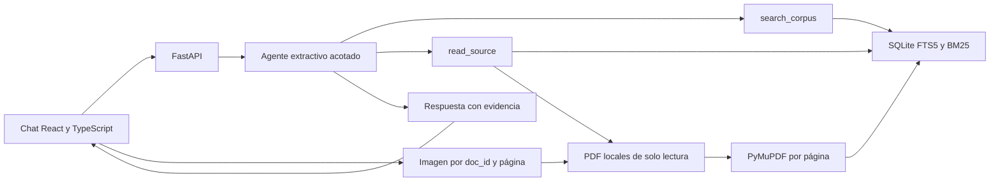

# Archivo financiero · RAG documental P0

Aplicación local para consultar reportes PDF y abrir la página que respalda una respuesta. El agente extractivo de este corte consulta el índice, lee fragmentos y selecciona una cita verificable. Devuelve texto del documento y declara evidencia insuficiente si la consulta carece de respaldo. Los documentos y las preguntas se procesan localmente.

## Arranque en desarrollo

Requisitos: Python 3.11 o superior con SQLite FTS5, uv, Node 22.12+ y npm. En la revisión del P0 se usaron Python 3.12 y Node 24. Desde la raíz:

```bash
uv sync --locked
npm ci --prefix apps/web
export RAG_DATA_DIR="$HOME/data"
export RAG_STATE_DIR="$HOME/.local/share/p2banorte"
uv run --locked python -m apps.api.corpus --limit 2
uv run --locked uvicorn apps.api.main:app --host 127.0.0.1 --port 8000
```

En el ensayo local con la entrega privada, selecciona `RAG_DATA_DIR="$PWD/docs/requirements/data"` y un `RAG_STATE_DIR` propio para ese corpus antes de indexar y arrancar la API. En un checkout público puedes usar una carpeta propia con PDF autorizados y texto seleccionable. En Coder se utiliza el corpus suministrado en `~/data`. El índice y los originales deben estar separados. El índice conserva la identidad de su raíz de datos.

En una segunda terminal:

```bash
npm --prefix apps/web run dev -- --port 5173
```

Abre **http://127.0.0.1:5173**. El servidor Vite envía `/api` al backend en el puerto 8000. Para otro puerto configura `RESOURCE_BASE_URL` en la terminal de Vite. La API publica su contrato en `http://127.0.0.1:8000/docs`.

## Comprobación manual

1. Comprueba que la biblioteca muestra los documentos indexados. Formula una pregunta sobre un concepto que hayas comprobado en una página concreta de un PDF.
2. Abre la cita y compara la imagen con esa misma página en tu lector de PDF. Cierra con Escape para volver a la cita.
3. Pregunta por un tema ajeno al corpus. La respuesta debe informar evidencia insuficiente.
4. Repite la ingesta con los mismos parámetros. El resumen de consola informa documentos reutilizados, nuevos y fallidos. `--limit 2` selecciona los dos PDF más pequeños para el primer corte. `--all` indexa todos los PDF elegibles. Cada ejecución publica atómicamente el conjunto seleccionado y conserva el índice anterior si se interrumpe antes del commit.

## Arquitectura V3



`GET /api/health` informa salud, modo y cantidad de documentos. `GET /api/documents` enumera el catálogo. `POST /api/chat` recibe `{"message":"…"}` y devuelve respuesta, citas, herramientas y modo de proveedor. `GET /api/documents/{doc_id}/pages/{pdf_page}/image` renderiza una página desde 1 y comprueba el hash del original. Los tamaños y el DPI de salida están limitados.

El P0 ofrece recuperación léxica y respuestas extractivas. En el entorno verificado `LLM_PROVIDER=extractive` es el modo predeterminado. La integración con inferencia generativa requiere un proveedor autorizado y su contrato. El presupuesto del agente limita llamadas y tiempo, y una configuración de proveedor indisponible produce un error recuperable. Comparación contable, cálculo con Decimal, tablas bajo demanda y evaluación de todo el corpus corresponden a etapas posteriores de V3.

## Pruebas

```bash
uv run --locked python -B -m pytest -q tests/p0 tests/harness
npm --prefix apps/web run build
cd apps/web
npx playwright install chromium
npm run smoke
```

La prueba de navegador levanta sus propios servidores de loopback en 8179 y 5179, genera un PDF ficticio en un directorio temporal y usa el Python de `.venv`. Puede usarse un Chromium preinstalado definiendo `PLAYWRIGHT_CHROMIUM_EXECUTABLE`. El smoke cubre cinco anchos de pantalla, foco, página original, abstención y recuperación de errores.

La evaluación con documentos reales y el estado de cada tarea se conservan en la [bitácora](docs/execution/EXECUTION_LOG.md) y en el [sprint P0](docs/execution/SPRINTS.md).
