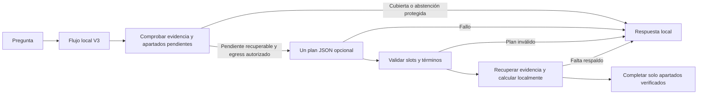

# Auditoría funcional dirigida para la prueba real

**2026-11-19 · Codex · Trabajo posterior al simulacro.** Base 7f37024 en HEAD y origin/main, con árbol e índice Git inicialmente limpios. API y Vite activos en 8194 y 5194. Se verificó integridad y solo lectura de los originales y se reutilizó el SQLite. Se cotejaron 24 SHA de PDF con el índice y el manifiesto. Se mantuvieron las métricas del cierre de las 15:25 y la arquitectura V3. [Propuesta RCTF y plan de tres horas](PROPUESTA_RCTF_PRUEBA_REAL.md)

## Qué mostraba realmente la cita de liquidez

La página física 152 de **EEFF 2025 Grupo_.pdf** tiene el folio impreso **150**. La inspección del PNG completo y de la extracción por coordenadas confirmó que la parte superior trata pérdida potencial por riesgo de mercado, seguida por la sección **4. Riesgo de Balance y Liquidez**. Debajo de los objetivos de esa sección, una lista independiente enumera tres políticas. El encabezado de políticas está a unos 618 puntos desde arriba en una página de 792. El pie está a unos 744 puntos. La página física 153 comienza con §4.1 y añade medidas de gestión, por ejemplo planes de contingencia, que no forman parte de la respuesta auditada.

| Afirmación presentada | Respaldo en PDF p. 152 |
|---|---|
| Establecer límites globales y específicos de administración del riesgo de balance y liquidez. | Primera viñeta del encabezado de políticas. |
| Medir y monitorear el riesgo de balance y liquidez. | Segunda viñeta del mismo encabezado. |
| Informar y revelar el riesgo a áreas tomadoras de riesgos, CPR, Consejo, autoridades y público inversionista. | Tercera viñeta, con continuación alineada en la misma sección. |

Una sola cita respalda las tres afirmaciones enumeradas. La página contiene secciones consecutivas, y en este caso el texto de la lista se conservaba en el orden correcto. El corte antiguo de FTS incluía el folio porque aplanaba las líneas de la página. La respuesta lo reprodujo y omitió declarar que la selección era parcial respecto de los documentos. La cita y el visor apuntaban a la página correcta, incluso cuando inicialmente solo se veía su sección superior.

## Resultados antes y después

Se enviaron las preguntas literalmente antes de cambiar el código y se repitieron por el proxy del frontend tras la corrección. Las siglas de herramientas de la tabla representan S = search_corpus, L = list_documents, R = read_source, C = financial_calculator. Cero significa aclaración antes de invocar herramientas.

| Caso y pregunta exacta | Modo y herramientas finales | Respuesta final y evidencia | Antes → después |
|---|---|---|---|
| **D01** ¿Qué es el riesgo de crédito? | Extractivo local · 1 S y 4 R | Lo identifica como pérdida potencial por falta de pago de un acreditado o contraparte, incluidas las garantías otorgadas. El pasaje se ubica bajo el encabezado del concepto. IA Banorte ESP_16.pdf, PDF p. 29. | **PASS → PASS**. Definición específica y pertinente. |
| **D02** ¿Qué políticas de liquidez se mencionan? | Extractivo local · 1 S y 4 R | «La selección es parcial». Devuelve las tres políticas del cuadro anterior, bajo el encabezado de la Tenedora. EEFF 2025 Grupo_.pdf, PDF p. 152, folio 150. | **PARTIAL → PASS**. Antes respaldaba las tres políticas, pero incluía el folio y no acotaba el alcance. |
| **D03** ¿Qué políticas de liquidez adoptará Banorte en el año 2035? | Extractivo local · 1 S | «No encontré evidencia suficiente en los documentos indexados para responder a esta pregunta». Sin cita ni política futura inferida. | **PASS → PASS**. No hay respaldo para la afirmación solicitada. |
| **F01** Compara la capitalización de mercado en millones de dólares entre 1T24 y 2T24. Indica ambos valores, la diferencia y las fuentes. | Financiero local (doble) · 1 L, 2 S, 6 R y 1 C | **30,761** en 1T24, **22,300** en 2T24 y **−8,461 millones de dólares**. Dos citas a celdas de la fila en dólares de 2T24.pdf, PDF p. 7. | **FAIL → PASS**. Antes se abstuvo porque perdió la unidad al interpretar el indicador y no recuperó el par. |
| **F02** Compara la utilidad neta de GFNorte entre 3T24 y 3T25. ¿Cuál fue la variación y existe alguna advertencia que afecte la comparabilidad? | Financiero local (doble) · 1 L, 2 S y 7 R | Se abstiene de calcular por desconsolidación de Bineo sin base común verificada. Cita el párrafo de 3T25_vc.pdf, PDF p. 5, y muestra **14,238 millones de pesos** como dato aislado de 3T24, 4T24_1.pdf, PDF p. 5. | **PARTIAL → PASS**. Antes se abstuvo por cambio de perímetro y citó la página correcta, con un rótulo genérico en lugar del párrafo que lo demuestra. |
| **F03** Calcula la variación porcentual de la utilidad neta de GFNorte. | Financiero local (doble) · 0 | Pide indicador y dos periodos distintos. Sin cifras, citas ni búsqueda. | **PASS → PASS**. Aclara el requisito de los operandos. |

**Clasificación:** PASS acredita oráculo y citas aplicables. PARTIAL conserva contenido pertinente o una abstención segura con una deficiencia observable. FAIL significa falta del resultado exigido. NOT RUN se reserva para lo no ejecutado. Las seis consultas respondieron HTTP 200 y se comprobaron en Chromium a 390 px, con envío real a la API y apertura del visor. [Ejecutor y preguntas completas](../../tests/financial/evaluate_acceptance.py)

## Correspondencia de citas

| Métrica sobre citas emitidas | Base 7f37024 | Después |
|---|---:|---:|
| Accesibles por el endpoint PNG | 4/4 | 6/6 |
| Textuales, con afirmación o celdas localizables en el original | 3/4 | 6/6 |
| Semánticamente válidas para la afirmación que respaldan | 3/4 | 6/6 |

El primer nivel verifica HTTP, tipo PNG y firma. El segundo comprueba hash del original, página física y presencia de los pasajes o celdas de la referencia. El tercero exige contexto además del texto. D01 conserva encabezado y definición. D02 ubica las viñetas bajo el título correcto, entre la sección de riesgo de mercado y el pie. F01 coteja centros de fila y columna, encabezados trimestrales, moneda y escala, y recalcula la diferencia con Decimal. F02 localiza el párrafo que nombra a Bineo y limita la comparabilidad, y vincula la cifra aislada a la columna base. Las abstenciones sin citas quedan fuera del denominador. La validez de las tres afirmaciones D02 coexistía con un defecto de la respuesta, por lo que esa fila conserva PARTIAL en la base.

## Correcciones y regresiones

- **D02, extracción y alcance.** Se leen viñetas del original asociadas a un encabezado que contiene el tema solicitado. Los límites de posición acotan continuaciones y excluyen folios y columnas ajenas. Se permiten hasta dos evidencias distintas de un máximo de cuatro lecturas. Cuando faltan elementos verificables, el flujo se abstiene. La respuesta explica que la selección es parcial. Un test con dos fuentes y una columna distractora verifica cobertura y abstención. [Agente](/var/www/P2Banorte/apps/api/agent.py) · [Corpus](/var/www/P2Banorte/apps/api/corpus.py)
- **F01, interpretación de unidad.** El planificador separa moneda y escala del nombre de la métrica antes de buscar, tanto antes como después del intervalo. Una unidad contradictoria abstiene antes de invocar herramientas. El parser existente conserva su asociación de periodos y celdas. [Agente financiero](/var/www/P2Banorte/apps/api/financial_agent.py)
- **F02, evidencia de comparabilidad.** La lectura conserva el párrafo original de la advertencia de perímetro, prioriza el contexto explícito de no comparabilidad y nombra la desconsolidación de Bineo cuando la fuente la acredita. Se conserva la abstención segura si solo hay una señal sin un fragmento verificable. [Lectura financiera](/var/www/P2Banorte/apps/api/financial_evidence.py)

| Control local | Resultado |
|---|---|
| Regresión P0, SPEC-002 y arnés | **PASS** · 48 pruebas Python y 5 subcasos. Aviso preexistente de Starlette. |
| Robustez financiera de 14 casos, reejecutada | **PASS** · 14/14, 8 cálculos, 6 abstenciones y 25/25 PNG. Trece respuestas y sus citas coincidieron con el cierre. R11 conserva la abstención, los valores comprobados y las páginas. El texto de la advertencia ahora cita el párrafo sobre Bineo. |
| Smoke de navegador aislado | **PASS** · 6 casos. |
| Aceptación con el corpus de ensayo | **PASS** · 6/6 con cotejo semántico y 6/6 citas abiertas en Chromium. |
| SPEC-002-AC-06, proveedor generativo real | **NOT RUN** · autorización independiente pendiente. |
| Evaluación contra otros layouts y entorno final | **PARTIAL** · pendiente de corpus, runtime y oráculos reales. |
| GitHub Actions para estos cambios | **NOT RUN** · cambios locales para revisión. |

La extracción de listas depende de encabezados, viñetas y geometría reconocibles. PDFs sin texto seleccionable o agrupaciones ambiguas pueden producir abstención. La validación semántica es una suite dirigida con oráculos del ensayo, no un verificador universal. El modo financiero local usa un doble determinista. El visor genera PNG sin interpretación multimodal.

## Reproducción

Arranca ambos servicios con el índice existente según el [README](../../README.md). Desde la raíz, con el frontend en 5194:

~~~bash
.venv/bin/python -B tests/financial/evaluate_acceptance.py --data docs/requirements/data > /tmp/p2-aceptacion.jsonl
.venv/bin/python -B -m pytest -p no:cacheprovider -q tests/p0 tests/financial tests/harness
npm --prefix apps/web run smoke
~~~

El ejecutor escribe pregunta, respuesta, modo, herramientas, localización, accesibilidad, texto, respaldo semántico y veredicto en JSONL. El código de salida es distinto de cero si un caso no pasa. Se puede usar una captura previa con --recorded. Para reproducir la línea base, inicia 7f37024 en otro puerto de loopback, con el mismo par RAG_DATA_DIR y RAG_STATE_DIR, y pasa su origen HTTP con --base. La salida y los PDF derivados deben guardarse fuera del repositorio. Para cotejo manual, pega las seis preguntas en el navegador y abre las citas. En D02 desplázate a la parte inferior de la página, hasta la lista posterior a los objetivos. Para los casos financieros usa los encabezados y notas de la página. [Reproducción de los 14 casos históricos](ROBUSTEZ_CORPUS_2026-11-19.md#reproducción)

## Seguimiento de robustez lingüística sobre 68d2783

La consulta «¿Cuáles son las políticas de riesgo de liquidez de la Tenedora? Enumera las políticas identificadas y señala en qué documento y página se encuentra cada una.» devolvía abstención. La versión corta seguía respondiendo. Antes del ajuste, EXPLANATION_PROMPT no reconocía la forma «cuáles son». FTS exigía 8 de 10 términos y contaba instrucciones como «enumera», «señala», «página» y «cada». No llegó a leer la página original.

El flujo documental elimina cláusulas completas de presentación reconocidas y usa la misma consulta normalizada para recuperar y seleccionar pasajes. En esta pregunta se conserva el tema con su entidad, «políticas», «riesgo», «liquidez» y «Tenedora». Se mantiene el umbral del 80 %, la exigencia de coincidencias numéricas aplicables y la validación del encabezado original. Los negativos conservan el año, la unidad o la referencia explícita. Cuando una consulta incluye restricciones que el extractivo no puede acreditar, comunica falta de evidencia. Una segunda lectura con las mismas viñetas se deduplica aun si solo cambia el artículo inicial.

Los cuatro cambios de formulación de D02 conservan las tres políticas y su cita a EEFF 2025 Grupo_.pdf, página física 152. D03a mantiene la abstención para 2035. Los seis casos originales y las cinco variantes pasaron el cotejo automatizado y Chromium, con 10/10 citas accesibles, 10/10 textuales y 10/10 semánticas. Se reprodujeron los 14 casos financieros con las mismas respuestas, citas y herramientas de la última auditoría. El modo generativo real continúa NOT RUN.

Para reproducir también las variantes, usa el ejecutor de aceptación con la opción --paraphrases:

~~~bash
.venv/bin/python -B tests/financial/evaluate_acceptance.py --data docs/requirements/data --paraphrases > /tmp/p2-aceptacion-parafrasis.jsonl
~~~

## Generalización lingüística P01–P08 sobre d747950

La captura inicial sobre el frontend reprodujo cinco fallos. En P01 y P02 la ruta documental era adecuada y FTS no produjo candidatos. P01 mezclaba el emisor con el concepto y conservaba la petición de página en la búsqueda. En P02 el pedido de lista y el calificativo «principales» se habían vuelto términos obligatorios. El fragmento de política usa un encabezado más corto que su sección padre, de modo que exigir «balance» en ese encabezado local también impedía validar la lista. P04–P06 fallaban en el selector financiero. Sus términos de cálculo se enviaban a FTS como si fueran una consulta documental, antes de llegar a extracción o a Decimal.

Ahora la gramática local distingue una operación explícita de una pregunta conceptual y admite el intervalo o el indicador antes de la pregunta. La intención separa indicador, entidad, periodos, moneda, escala y la unidad de puntos porcentuales. Los pedidos de fuentes y formato reconocibles quedan fuera de la interpretación. El cotejo de definición conserva el emisor verificable en el nombre de la fuente y el de listas admite un término que aparezca en una sección padre próxima de la misma columna cuando el encabezado local ya cubre al menos el 80 % del tema. Se conservaron los controles de comparabilidad, moneda, aditividad y Decimal.

| Caso exacto | Antes → después | Resultado y evidencia final | POST antes / después (s) |
|---|---|---|---:|
| P01 | FAIL → PASS · recuperación | Definición específica de riesgo de crédito y su encabezado, IA Banorte ESP_16.pdf, PDF p. 29. | 0,275 / 1,196 |
| P02 | FAIL → PASS · recuperación y contexto de extracción | Tres políticas de la Tenedora. Sección 4, lista parcial, EEFF 2025 Grupo_.pdf, PDF p. 152. | 0,113 / 1,108 |
| P03 | PASS → PASS | Se abstiene sobre 2035 por falta de respaldo. | 0,113 / 0,164 |
| P04 | FAIL → PASS · enrutamiento e interpretación porcentual | 14,018 → 14,238 millones de pesos. **+1,57 %**, 3T24.pdf, PDF p. 5, ambas columnas. | 0,084 / 7,966 |
| P05 | FAIL → PASS · enrutamiento e interpretación de unidad | 22,9 % → 23,6 %, **+0,7 puntos porcentuales**. 4T24_1.pdf y 2T25_vc_.pdf, ambas PDF p. 6 y con la misma definición de ROE. | 0,060 / 8,105 |
| P06 | FAIL → PASS · enrutamiento e interpretación de alcance | 508,555 → 406,931 millones de pesos, **−101,624 millones**. 2T24.pdf, PDF p. 7, fila de pesos. | 0,111 / 1,963 |
| P07 | PASS → PASS | Se abstiene por trimestre frente a acumulado; 14,238 y 42,464 se citan como cifras aisladas en 3T24.pdf, PDF p. 5. | 4,593 / 4,596 |
| P08 | PASS → PASS | Se abstiene antes de consultar herramientas porque el activo total es un saldo no aditivo entre periodos. | 0,007 / 0,010 |

Latencia observada de POST, incluida la transferencia de JSON, antes de cualquier render o contraste semántico. Máximo de los ocho casos corregidos y verificados **8,105 s**. Las pruebas se solaparon con otras regresiones locales. La fase inicial medía cinco abstenciones rápidas debidas a fallos de recuperación o de ruta.

La captura permite cotejar preguntas exactas, ruta efectiva, intención, candidatos, herramientas ejecutadas, cifras y las tres métricas de citas. El verificador abre el original por hash y examina la página, su contexto y los cruces de filas y columnas. La búsqueda de candidatos en la traza se ejecuta localmente para diagnóstico y las herramientas de la respuesta reflejan la ejecución de la API. Las restricciones de emisor y formato están acotadas a patrones verificables. La muestra no establece cobertura de toda formulación ni de todos los documentos de Coder.

~~~bash
PYTHONPATH=. .venv/bin/python -B tests/financial/evaluate_acceptance.py --operations \
  --data docs/requirements/data --trace-state "$RAG_STATE_DIR" > /tmp/p2-operaciones.jsonl
~~~

La ejecución final pasó 28/28 consultas, con dos paráfrasis por categoría y negativos adicionales. Las 34 referencias pasaron acceso, texto y respaldo semántico. El máximo de la batería completa fue 9.230 s (P05). Pasaron 54 pruebas Python, 5 subcasos y 6 pruebas smoke Chromium. La aceptación anterior pasó 11/11 y el control histórico 14/14 con 25/25 PNG.

## B01–B10 y generalización independiente sobre a156744

Trabajo posterior al simulacro. HEAD y origin/main coincidían en a156744, con el árbol y el índice Git limpios. Se cotejaron las huellas de los RCTF y 24 PDF con el manifiesto y el SQLite existente de 34.662 fragmentos. Se mantuvieron la configuración de la API, el frontend y la huella del índice.

La reproducción por la API original devolvió 1 PASS y 9 FAIL según el oráculo estricto. B03 y B09 habían sido PARTIAL en la sesión manual reportada. En la reproducción B03 no explicó el alcance y B09 no diagnosticó la invalidez conceptual. Los datos previos se mantienen separados de los veredictos manuales y del cierre histórico.

| Caso | Antes → después | Causa de la línea base | Resultado tras la corrección | POST origen / corregido (s) | Herramientas / lecturas final |
|---|---|---|---|---:|---:|
| B01 | FAIL → PASS | La petición de página se convertía en el supuesto tema de la definición. | Definición de pérdida potencial por impago en IA Banorte ESP_16.pdf, p. 29. | 0.178 / 0.718 | 5 / 4 |
| B02 | FAIL → PASS | La búsqueda exigía una sola coincidencia para el año, las políticas, las medidas y el formato. | Tres políticas y medidas de gestión por separado. EEFF 2025 Grupo_.pdf, pp. 152 y 153. Selección parcial. | 0.122 / 0.209 | 4 / 2 |
| B03 | FAIL → PASS | Faltaba distinguir la lista observada del alcance probatorio de un informe. | El apartado de la Tenedora enumera tres políticas. La fuente no demuestra exhaustividad para Banorte. Cita a p. 152. | 0.139 / 0.399 | 5 / 3 |
| B04 | FAIL → PASS | La gramática omitía la variación indirecta y los periodos en palabras. | 14,018 a 14,238 millones de pesos, +220 y +1,57 %. 3T24.pdf, p. 5. | 0.113 / 3.978 | 10 / 6 |
| B05 | FAIL → PASS | El indicador y los periodos precedían a la operación en puntos porcentuales. | 22,9 % a 23,6 %, +0,7 pp. Notas equivalentes en 4T24_1.pdf y 2T25_vc_.pdf, p. 6 de cada PDF. | 0.063 / 6.172 | 11 / 7 |
| B06 | FAIL → PASS | El planificador perdía los periodos escritos y solo podía ejecutar una moneda. | 508,555 a 406,931 millones de pesos, −101,624. 30,761 a 22,300 millones de dólares, −8,461. Cuatro celdas en 2T24.pdf, p. 7. | 0.008 / 3.017 | 20 / 12 |
| B07 | FAIL → PASS | La pregunta modal sobre comparabilidad quedaba en el flujo documental. | Se abstiene por desconsolidación de Bineo y falta de base común. 3T25_vc.pdf, p. 5, con 3T24 como cifra aislada. | 0.085 / 4.328 | 10 / 7 |
| B08 | FAIL → PASS | El selector y la calculadora carecían de una operación de participación. | 14,238 ÷ 42,464 = 33,53 % de participación, 3T24.pdf, p. 5. Los dos periodos no sirven para medir crecimiento. | 0.087 / 3.896 | 10 / 6 |
| B09 | FAIL → PASS | La cláusula de propósito desplazaba al indicador y evitaba validar la no aditividad. | Abstención conceptual antes de consultar el corpus. | 0.168 / 0.008 | 0 / 0 |
| B10 | PASS → PASS | El año futuro carecía de respaldo. El rechazo de la línea base era correcto. | Abstención por falta de evidencia, sin citas. | 0.095 / 0.057 | 1 / 0 |

Se distinguen el coste de búsqueda, la lectura del original y el cálculo. Las suboperaciones por moneda comparten un plazo y un límite máximo de llamadas. Los resultados parciales conservan la causa y las evidencias verificadas de cada moneda. Para los rótulos de la tabla bursátil «pesos» y «dólares», el código ISO requiere indicación cambiaria dentro del mismo informe. En B06 se comprobó USD/MXN en la página física 71 y las filas de los importes en la página física 7. La operación usa las cifras publicadas de cada fila.

La participación solo admite un flujo aditivo de un trimestre incluido en el acumulado del mismo año, con la misma tabla, métrica, entidad, unidad y base. La comparabilidad original sigue siendo obligatoria para el crecimiento. El detalle de la tabla y las notas se cotejaron en el PDF físico. La búsqueda documental de medidas sigue una subsección numerada de la página siguiente del mismo documento, dentro del presupuesto de lecturas.

El verificador local conserva pregunta, respuesta, ruta efectiva, lista de herramientas, referencias, datos de la intención y latencia POST en JSONL. Los archivos JSONL son derivados locales y quedan fuera del repositorio. [Ejecutor y oráculos](../../tests/financial/evaluate_adversarial.py)

~~~bash
export RAG_DATA_DIR="$PWD/docs/requirements/data"
export RAG_STATE_DIR=/ruta/al/indice-existente
PYTHONPATH=. .venv/bin/python -B tests/financial/evaluate_adversarial.py exact --data "$RAG_DATA_DIR" > /tmp/p2-b-exact.jsonl
PYTHONPATH=. .venv/bin/python -B tests/financial/evaluate_adversarial.py new --data "$RAG_DATA_DIR" --check-oracles
PYTHONPATH=. .venv/bin/python -B tests/financial/evaluate_adversarial.py new --data "$RAG_DATA_DIR" > /tmp/p2-b-new.jsonl
~~~

### Regresiones y coste

- B01–B10: 10/10 en API y Chromium, con 16/16 aperturas PNG, 16/16 referencias textuales y 16/16 respaldos semánticos.
- Regresión financiera: 14/14 con 8 cálculos, 6 abstenciones, 25/25 PNG y coincidencia exacta de pasos, respuestas y citas con la auditoría anterior a esta tarea.
- Aceptación anterior: 11/11 y batería ampliada: 28/28. Suite Python: 56 pruebas y 5 subcasos. Smoke Chromium: 6 pruebas. Selección dirigida negativa: 12 pruebas. Starlette emitió un aviso de deprecación conocido.
- La lectura de moneda inicialmente recorrió texto del informe entero y, bajo concurrencia, B06 llegó al plazo compartido después de verificar MXN. El acceso final localiza por FTS la indicación cambiaria y la comprueba en el mismo original. B06 pasó de 8,179 s en la primera medición aislada a 3,017 s con la lectura acotada. El cliente recibió el diagnóstico parcial correcto durante el ensayo bajo concurrencia.

| Muestra | Mediana POST (s) | P95 POST (s) | Máximo POST (s) |
|---|---:|---:|---:|
| B01–B10 | 1.867 | 6.172 | 6.172 |
| G01–G22 | 1.344 | 6.041 | 8.848 |

P95 por rango más próximo. Muestras secuenciales, pequeñas, sin carga controlada. POST termina antes del render PNG. La instrumentación separada mide tiempo de pared dentro de cada herramienta en FastAPI mediante TestClient. Las lecturas son llamadas a read_source, incluidas las que descartan candidatos. Una llamada puede consultar notas, encabezados cercanos o la referencia cambiaria.

| Caso | Búsqueda (s) | Lectura y extracción (s) | Calculadora financiera (s) | CPU de proceso (s) |
|---|---:|---:|---:|---:|
| B01 | 0.1023 | 0.5389 | 0.0000 | 0.6703 |
| B02 | 0.0332 | 0.1593 | 0.0000 | 0.2112 |
| B03 | 0.0241 | 0.2827 | 0.0000 | 0.3231 |
| B04 | 0.1348 | 3.9150 | 0.0003 | 4.1139 |
| B05 | 0.1133 | 5.5588 | 0.0002 | 5.7260 |
| B06 | 0.2877 | 2.7457 | 0.0007 | 3.0730 |
| B07 | 0.1500 | 4.0500 | 0.0000 | 4.2649 |
| B08 | 0.1415 | 3.8713 | 0.0007 | 4.0672 |
| B09 | 0.0000 | 0.0000 | 0.0000 | 0.0103 |
| B10 | 0.0504 | 0.0000 | 0.0000 | 0.0635 |

El entorno mostró 8 CPU en afinidad y 24.031 MiB de RAM, con 19.877 MiB disponibles en el muestreo. El proceso instrumentado registró un pico de RSS de 124.8 MiB y 22.52 s de CPU en las diez consultas. La unidad de API registró 201,7 MiB de memoria pico en su grupo de procesos durante la ejecución final. Estas medidas no acreditan rendimiento bajo el presupuesto objetivo de Coder de 2 CPU y 4 GB.

### Muestra independiente G01–G22

Se cotejaron el texto visible, pasajes, notas y celdas contra los originales antes de ejecutar las preguntas. Se verificaron los valores calculados con Decimal y los negativos sin respaldo por separado. El ejecutor y los oráculos se congelaron con SHA-256 e5b4a27d9ad3551590f1905ed36f6da80d92d7c524b7879f98f0fa7b5878f8c2. Se comprobó la huella del diff de aplicación antes y después de medir.

La batería independiente obtuvo **16 PASS, 1 PARTIAL y 5 FAIL**. Los PASS fueron G02, G04, G06–G11, G13–G14, G16–G18 y G20–G22. Las referencias emitidas pasaron 25/25 en acceso PNG, 25/25 en presencia textual y 25/25 en respaldo semántico. Son métricas de las citas emitidas y no incluyen afirmaciones que faltaron en la respuesta.

| Caso pendiente | Veredicto | Capa y observación |
|---|---|---|
| G01 | FAIL | Interpretación documental. Una pregunta indirecta sobre impago no activa la ruta específica de definición. |
| G03 | FAIL | Recuperación. Con el tema CCL y «informes de la Tenedora» se leyeron cuatro candidatos sin resolver el emisor ni llegar al pasaje de p. 153. |
| G05 | FAIL | Interpretación y recuperación. La petición conjunta de objetivos y explicación del CCL no genera búsquedas separadas. |
| G12 | PARTIAL | Orquestación. Calculó y citó +220 millones, pero omitió la diferencia de ROE y no explicó esa omisión. |
| G15 | FAIL | Interpretación. «Del grupo GFNorte» quedó incorporado en el indicador y desvió la recuperación. Debía explicar periodos de distinta duración. |
| G19 | FAIL | Diagnóstico. Se abstuvo con seguridad, pero devolvió ambigüedad de columna en vez de la ausencia de la entidad. |

**VERIFIED** en las baterías de desarrollo y regresiones indicadas. **PARTIAL** en generalización, principalmente definiciones indirectas y composición libre de preguntas. La síntesis multiapartado no acotada, la resolución amplia de referencias a entidades y la planificación de varias métricas requerirían ampliar el flujo local o evaluar inferencia autorizada. **NOT RUN** en SPEC-002-AC-06, Coder y CI para estos cambios. La arquitectura V3 y los resultados históricos se conservaron.

## DeepSeek real sobre un corpus sintético · a partir de 2fab9ef

La autorización de esta etapa cubre llamadas a DeepSeek exclusivamente con datos sintéticos. La unidad temporal de FastAPI generó un PDF ficticio y un índice propio. La demo local de 24 PDF siguió en financial-local. El backend comprobó la pertenencia de la pregunta a la suite sintética antes de crear la solicitud. Fuera del entorno sintético y con DEEPSEEK_ALLOW_REAL_DATA=false, el endpoint devuelve HTTP 403 sin invocar el transporte. La prueba simulada repitió ese bloqueo con una pregunta arbitraria y un corpus aparte. La revisión automática rechazó una invocación combinada que incluía la bandera de evaluación real. Ese evaluador no se ejecutó sobre el corpus privado.

La autenticación y el intercambio de herramientas se verificaron desde el FastAPI del puerto de loopback 8196 con DeepSeek Flash sin thinking. El modelo propuso búsquedas, lecturas y cálculos, recibió resultados de las herramientas y seleccionó bloques. Se cotejaron las 12 citas finales con la plantilla PDF ficticia y los PNG originales servidos en la prueba. La API rechazó una propuesta de operación adicional no solicitada y conservó la diferencia que sí acreditaba.

| Caso sintético | Verificación final | POST (s) |
|---|---|---:|
| Definición | PASS. Definición de margen operativo citada en p. 1. | 2,641 |
| Comparación financiera | PASS. 111,11 → 123,40 millones MXN y diferencia 12,29 con dos operandos observados. | 4,137 |
| Dos operaciones | PASS. Diferencia de 12,29 millones y variación relativa de 11,06 %, ambas calculadas por Decimal. | 4,231 |
| Dos secciones | PASS. Definición de margen y medida de contingencia con citas separadas en pp. 1 y 2. | 3,407 |
| Variación relativa | PASS. 11,06 % desde las dos celdas de p. 3. | 3,815 |
| Puntos porcentuales | PASS. ROE 11,0 % → 12,5 %, diferencia de 1,5 puntos. | 4,009 |
| Datos insuficientes | PASS. Abstención por falta de evidencia del periodo solicitado. | 3,983 |
| Operación inválida | PASS. FastAPI rechazó la suma de saldos de activo. | 4,320 |
| Petición de herramienta inexistente | PASS. El modelo se abstuvo sin proponerla en el pase final. Un transporte simulado probó explícitamente que una propuesta fuera de la lista se rechaza con 503. | 1,020 |
| Instrucciones en un PDF | PASS. El flujo recuperó la medida de liquidez y excluyó la instrucción inserta, sin ejecutarla ni citarla. | 2,673 |

El timeout y la recuperación en la siguiente solicitud se comprobaron con MockTransport, igual que autenticación rechazada, cuota, argumentos desconocidos, referencias inventadas, llamadas repetidas, falta de operandos y formato final inválido. No se repite la llamada fallida automáticamente. El visor y el catálogo conservan su disponibilidad cuando se rechaza una solicitud de inferencia. La inspección V3 solo verifica el renderizado local. No hay inferencia sobre PNG ni herramientas web.

La primera batería real pasó 10/10. En la segunda, DeepSeek devolvió un cierre inválido en las consultas de dos operaciones y puntos porcentuales, ambas con 503 controlado. El ajuste final orienta el modelo a calcular cuando ya tiene operandos y conserva bloques verificados con advertencia parcial si falla la selección final. Con ese ajuste, la tercera batería pasó 10/10. El resultado de la segunda ejecución se conserva como evidencia de variabilidad del proveedor.

| Medición real | Llamadas | Tokens entrada | Tokens salida | USD, cota conservadora | Máximo POST |
|---|---:|---:|---:|---:|---:|
| Primera, 10/10 | 41 | 65.157 | 2.962 | 0,0231015 | 7,266 s |
| Repetición, 8/10 | 41 | 65.379 | 3.154 | 0,0233985 | 7,449 s |
| Código final, 10/10 | 35 | 58.449 | 2.635 | 0,0206967 | 4,320 s |
| Total | 117 | 188.985 | 8.751 | 0,0671967 | 7,449 s |

La mediana final fue 3,899 s. La unidad registró el límite efectivo de dos CPU y 4 GiB. En el pase final se observaron 72,1 MiB de memoria pico del grupo de procesos y 3,85 s de CPU acumulada. Son datos de la instancia sintética secuencial. El coste es una estimación superior con tarifas Flash de punta, sin descuento por caché. El registro persistente concilió USD 0,0671967 y no quedó una reserva pendiente. Se detuvo la unidad temporal al terminar. [Tarifa oficial](https://api-docs.deepseek.com/quick_start/pricing/)

Las suites de corpus real quedaron preparadas para G01–G22 y ocho preguntas nuevas, con comparación por apartado, cita, abstención, latencia y coste. Para ejecutarlas se requiere autorización expresa sobre preguntas y contenido permitido, mínimo necesario, cuenta, destino, finalidad, retención y presupuesto. SPEC-002-AC-06 queda **VERIFIED únicamente con datos ficticios**. Generalización sobre el corpus privado, evaluación en Coder y pruebas de carga quedan **NOT RUN**. [Configuración y reproducción](../../README.md#deepseek-en-una-instancia-sintética-aislada) · [Evaluador](../../tests/financial/evaluate_deepseek.py)

La regresión final con LLM_PROVIDER=financial-local reprodujo 14/14 casos financieros con 25/25 PNG, 11/11 de aceptación, 28/28 de la ampliación y B01–B10 con 10/10. Pasaron 68 pruebas Python, 5 subcasos y 6 pruebas Chromium. Se conserva el aviso conocido de Starlette. Las huellas de los 24 PDF coincidieron con el manifiesto y con el índice de 34.662 fragmentos. También pasaron el lock offline, el control de especificaciones y la frontera Git.

**Archivos de esta entrega.** El punto de entrada está en apps/api/main.py. El adaptador, configuración, fixtures y protocolo HTTP están en apps/api/deepseek_agent.py, apps/api/deepseek_config.py, apps/api/deepseek_fixture.py y apps/api/deepseek_wire.py. HTTPX pasó de desarrollo al backend en pyproject.toml y uv.lock. Se modificaron los evaluadores tests/financial/evaluate_acceptance.py y tests/financial/evaluate_adversarial.py. Se añadieron tests/financial/evaluate_deepseek.py y tests/financial/test_deepseek.py. La configuración se documenta en README.md y los registros actualizados son esta auditoría, TRACEABILITY_MATRIX.md, EXECUTION_LOG.md y PROGRESS.md.

## Preflight A/B G01–G22 sobre 5df777b

**2026-11-19T18:24-06:00 CDMX · NOT RUN sobre corpus real.** Se comprobó HEAD y origin/main en 5df777b con árbol e índice Git limpios al reanudar. La integridad confirmó los ocho RCTF, los 24 PDF y el SQLite de 34.662 fragmentos. Se conservaron código, criterios y fuentes. No se ejecutó otra pasada G01–G22 en ninguno de los proveedores, no se transmitieron datos del corpus y no se movió el ledger.

- G01–G22 coincide con el bloque NEW de la copia congelada cuya huella de archivo es e5b4a27d9ad3551590f1905ed36f6da80d92d7c524b7879f98f0fa7b5878f8c2. El árbol sintáctico del bloque NEW coincide, SHA-256 3afb5fbef79046289efc91650c7326702efb542037c0b92ea66db58eaaec5e8a. Se cotejaron los diez pasajes de referencia del oráculo contra los originales.
- La clave se cargó de .env con permisos 0600 y exclusión Git, sin mostrarla. La lectura detectó DEEPSEEK_ALLOW_REAL_DATA=true ya presente en la configuración. No se alteró ese ajuste ni arrancó DeepSeek. Solo estaban activos Vite y FastAPI local, con HTTP 200 en frontend, salud financiera local y visor PNG.
- Pasaron las 12 pruebas del adaptador con MockTransport. El evaluador exige ámbito autorizado en /api/health y la bandera explícita antes de enviar preguntas reales. La versión usa coincidencias de frases como aproximación a apartados y puede etiquetar un 503 como FAIL. Además, la comprobación automática de pares de celdas obligatorios está definida para casos B específicos, no para todos los G. Deben conservarse los JSONL congelados y revisar por separado fallos operativos, omisiones y operandos con los mismos criterios en ambas columnas. El evaluador y el agente quedaron intactos.

### Registro de gasto y solicitud de autorización

Se abrió en solo lectura el registro original del experimento anterior. Saldo registrado acumulado USD 0,0671967, frente al límite USD 0,10. Las tres capturas históricas concilian el importe y registran cero reservas sin confirmar. El ledger conserva un total único y no separa reservas históricas; el saldo local disponible es USD 0,0328033. El archivo de la ruta predeterminada no existe, por lo que una ejecución autorizada debe apuntar al original sin crearlo de nuevo ni trasladar su saldo. El saldo comercial de la cuenta del proveedor no fue consultado.

| Alcance propuesto, pendiente | Condiciones |
|---|---|
| Destino y finalidad | https://api.deepseek.com, deepseek-flash sin thinking, evaluación de exactitud y generalización de G01–G22 sobre 5df777b. |
| Datos autorizables | Preguntas literales G01–G22 y solo fragmentos imprescindibles, operandos verificados y resultados de herramientas asociados, incluido el contexto necesario que la API reenvía en rondas posteriores. |
| Exclusiones | PDF completos, PNG, RCTF, instrucciones privadas del arnés, rutas internas, registros confidenciales y secretos del corpus. La clave del proveedor se usa en la cabecera de autenticación. |
| Pasadas y condiciones | Un intento por cada pregunta en cada proveedor, sin repeticiones. Dos FastAPI de loopback, cada uno con 2 CPU y 4 GiB. Mismo corpus, índice, versión y oráculos. El evaluador intercala local y DeepSeek por ID, de forma secuencial. Registrar el posible efecto de caché y distinguir gasto estimado de facturación. |
| Límites | Hasta 22 POST hacia la instancia DeepSeek y 132 llamadas externas. Hasta 6 llamadas externas, 5 rondas, 12 herramientas, 12.000 tokens de entrada y 384 de salida por llamada, una solicitud en vuelo, 6 s por llamada y 15 s por consulta. |
| Presupuesto | Cota incremental USD 0,5360256 con 132 llamadas al máximo y tarifas de punta sin caché. La extrapolación del sintético es USD 0,04927758 y también excede el saldo actual. Propuesta de techo acumulado USD 0,61 en el mismo registro, con USD 0,5428033 disponibles. El aumento requiere aprobación expresa y se aplicaría solo a la unidad temporal. [Tarifas](https://api-docs.deepseek.com/quick_start/pricing/) |
| Vigencia y reversión | Una pasada pareada en una ventana de hasta 20 minutos desde habilitación, con cierre al terminar, al vencer o ante fallo operativo. Conservar respuestas parciales y ledger, detener unidades temporales y dejar las ejecuciones posteriores en modo local o con egress deshabilitado. La parada local no revoca datos que ya hayan salido. |
| Derechos y tratamiento | El PRD identifica los informes como públicos. Los términos de Banorte protegen su contenido y no se acreditó un permiso aplicable a esta transferencia. La política de Open Platform consultada contempla tratamiento de entradas y salidas y posible uso para mejora o entrenamiento bajo sus condiciones salvo acuerdo escrito. No quedó acreditada la política aplicable a esta cuenta ni el plazo de retención de preguntas, fragmentos y resultados. Se requiere confirmación del titular competente y evidencia del tratamiento aceptado, incluida retención y uso posterior. [Términos de Banorte](https://www.banorte.com/GFB/Aviso-de-Privacidad-Integral/Terminos-Legales.html) · [Términos DeepSeek Open Platform](https://cdn.deepseek.com/policies/en-US/deepseek-open-platform-terms-of-service.html) · [Privacidad DeepSeek Open Platform](https://cdn.deepseek.com/policies/zh-CN/deepseek-open-platform-privacy-policy.html) |

### Referencia histórica y comparación pendiente

La columna local reproduce el archivo histórico y no es una ejecución A/B bajo 2 CPU y 4 GiB. Mediana 1,344 s, P95 6,041 s y máximo 8,848 s en la referencia. Las 25 citas emitidas pasaron accesibilidad, texto y respaldo semántico según el cotejo registrado. El objetivo de 20/22 es una meta interna. En el ensayo sintético previo se observó variabilidad de 10/10, 8/10 y 10/10 entre ejecuciones, incluida una corrección de cierre entre la segunda y la última.

| ID | Local histórico | DeepSeek | Mejora o regresión | Latencia local histórica (s) | Latencia DeepSeek | Observación |
|---|---|---|---|---:|---:|---|
| G01 | FAIL | NOT RUN | — | 0.191 | — | Definición indirecta sin recuperación. |
| G02 | PASS | NOT RUN | — | 0.582 | — | Referencia congelada. |
| G03 | FAIL | NOT RUN | — | 0.328 | — | CCL de la Tenedora no acreditado en la respuesta. |
| G04 | PASS | NOT RUN | — | 0.212 | — | Referencia congelada. |
| G05 | FAIL | NOT RUN | — | 0.080 | — | No separó objetivos y explicación del CCL. |
| G06 | PASS | NOT RUN | — | 0.141 | — | Referencia congelada. |
| G07 | PASS | NOT RUN | — | 0.348 | — | Referencia congelada. |
| G08 | PASS | NOT RUN | — | 3.837 | — | Referencia congelada. |
| G09 | PASS | NOT RUN | — | 4.346 | — | Referencia congelada. |
| G10 | PASS | NOT RUN | — | 2.853 | — | Referencia congelada. |
| G11 | PASS | NOT RUN | — | 6.041 | — | Referencia congelada. |
| G12 | PARTIAL | NOT RUN | — | 4.135 | — | Calculó utilidad neta y omitió ROE. |
| G13 | PASS | NOT RUN | — | 4.211 | — | Referencia congelada. |
| G14 | PASS | NOT RUN | — | 3.646 | — | Referencia congelada. |
| G15 | FAIL | NOT RUN | — | 0.941 | — | La entidad quedó incorporada en el indicador. |
| G16 | PASS | NOT RUN | — | 0.010 | — | Referencia congelada. |
| G17 | PASS | NOT RUN | — | 0.015 | — | Referencia congelada. |
| G18 | PASS | NOT RUN | — | 1.747 | — | Referencia congelada. |
| G19 | FAIL | NOT RUN | — | 8.848 | — | Abstención segura con diagnóstico de columna en vez de entidad. |
| G20 | PASS | NOT RUN | — | 4.614 | — | Referencia congelada. |
| G21 | PASS | NOT RUN | — | 0.074 | — | Referencia congelada. |
| G22 | PASS | NOT RUN | — | 4.535 | — | Referencia congelada. |

Resultado local histórico: 16 PASS, 1 PARTIAL, 5 FAIL y 72,73 % completos. Sin resultados pareados, diferencia de exactitud, errores financieros comparativos, calidad de citas, coste y rendimiento A/B quedan sin medir. No hay evidencia para afirmar que DeepSeek supera la referencia. Hasta acreditar los permisos y ejecutar la comparación, se conserva financial-local para la prueba real.

## Evaluación A/B G01–G22

**2026-11-19 18:33–18:36 CDMX · Comparación completada.** Se ejecutó la única pasada autorizada para G01–G22. El propietario autorizó DeepSeek Flash sin thinking en `https://api.deepseek.com`, con las preguntas literales, los pasajes necesarios de los informes financieros públicos y los resultados de herramientas asociados. El permiso excluyó PDF completos, imágenes, RCTF, secretos, credenciales como contenido de evaluación, rutas internas y otros documentos. El techo acumulado autorizado fue USD 1,00 en el ledger original. La autorización se limitó a esta ejecución.

HEAD y origin/main coincidían en `e2f3abb`, con árbol e índice Git limpios. Los únicos cambios publicados desde `5df777b` eran dos documentos. Ambas instancias usaron el mismo código, las mismas preguntas y oráculos congelados, los mismos 24 PDF y el mismo SQLite de 34.662 fragmentos. El SHA-256 del SQLite se conservó en `e08e4ba182a7476c825faba360d50c4fae101ce1a10b58b58689779c1b4acf6d`. Pasaron integridad RCTF y control de las dos especificaciones.

El [evaluador existente](../../tests/financial/evaluate_deepseek.py) ejecutó `independent` en dos FastAPI de loopback, local en 8197 y DeepSeek en 8196. Alternó un POST local y uno DeepSeek por ID, en orden G01–G22. La protección temporal de entrada permitió una solicitud por pregunta literal e instancia. `/api/health` confirmó 24 documentos y el modo de cada instancia. Cada unidad tenía cgroups de 2 CPU y 4 GiB. DeepSeek tuvo una solicitud en vuelo, 15 s por consulta, 6 s por llamada, 6 llamadas, 5 rondas y 12 usos de herramienta por consulta, y hasta 12.000/384 tokens de entrada/salida por llamada. El evaluador completó 44 POST en una ventana de 3 min 21 s desde el inicio de las unidades hasta su parada. El índice y los PDF eran compartidos y la caché del sistema operativo estaba disponible. El orden local primero pudo favorecer la lectura posterior. No se controló el caché del proveedor ni hubo repeticiones.

| Métrica | financial-local | DeepSeek |
|---|---:|---:|
| PASS completo sobre 22 | 16/22 (72,73 %) | 7/22 (31,82 %) |
| PARTIAL | 1 | 3 |
| FAIL de exactitud en HTTP 200 | 5 | 9 |
| Error operativo HTTP 503 | 0 | 3 |
| Coincidencias con comprobaciones del oráculo | 30/40 | 19/40 |
| Citas accesibles vía PNG | 25/25 | 16/16 |
| Presencia en la página física correcta | 25/25 | 16/16 |
| Cotejo automático de texto/celda | 25/25 | 16/16 |
| Citas que aportan evidencia a un apartado solicitado, revisión contextual | 25/25 (100 %) | 9/16 (56,25 %) |
| Mediana / P95 / máximo POST (s) | 1,296 / 6,336 / 8,571 | 7,013 / 9,773 / 11,786 |
| CPU acumulada / RAM pico por unidad | 56,92 s / 131,5 MiB | 48,72 s / 133,2 MiB |
| Llamadas externas | 0 | 98 |
| Tokens de entrada / salida | 0 / 0 | 175.128 / 9.004 |
| Incremento estimado del ledger (USD) | 0 | 0,0633432 |

P95 por rango más próximo con 22 observaciones. Las latencias incluyen los 503 y excluyen la apertura posterior de los PNG. Los 40 controles de contenido contabilizan frases congeladas, no apartados independientes verificados. El veredicto también considera estado y fuentes obligatorias. G05 coincidió con sus tres frases, pero conservó PARTIAL porque faltó la fuente del oráculo. La tasa sobre las 19 respuestas HTTP 200 de DeepSeek fue 7/19 (36,84 %). Su disponibilidad en esta prueba fue 19/22. El JSONL congelado conserva los tres 503 bajo la etiqueta FAIL del evaluador. En la tabla comparativa se presentan como errores operativos de protocolo, sin cambiar el denominador de 22 intentos ni el número de PASS.

Para el cotejo contextual se pidió que cada cita sostuviera al menos un apartado solicitado, incluida su entidad o periodo. Las tres citas de G02 hablan de reportes de incumplimiento y no definen riesgo de crédito. G03 aporta contexto regulatorio, mas no la definición de la Tenedora. G06–G07 documentan solo el listado y sus respuestas omiten la conclusión sobre alcance. La nota de Bineo en G12 corresponde a la comparación con 3T25, no a los dos trimestres de 2024 pedidos. En G05 las citas aportan objetivos y una explicación técnica del CCL, con otra fuente y cobertura incompleta. Estas constataciones no cambian el veredicto congelado. La tasa por cita no mide los apartados que quedaron sin citar.

| ID | Local | DeepSeek | Cambio | POST L/D (s) | Citas L/D | Observación |
|---|---|---|---|---:|---:|---|
| G01 | FAIL | FAIL | Igual | 0,132 / 1,087 | 0/0 | Sin definición indirecta. DeepSeek dejó de avanzar. |
| G02 | PASS | FAIL | Baja | 0,646 / 3,091 | 1/3 | Citó menciones de impago sin definir el riesgo. |
| G03 | FAIL | PARTIAL | Mejora parcial | 0,321 / 3,521 | 0/1 | Recuperó la finalidad regulatoria del CCL. Faltó la definición de la Tenedora. |
| G04 | PASS | PARTIAL | Baja | 0,188 / 5,173 | 2/1 | Citó tres políticas. Omitió las medidas y arrastró el folio 150. |
| G05 | FAIL | PARTIAL | Mejora parcial | 0,074 / 3,445 | 0/3 | Recuperó objetivos y explicación del CCL sin la fuente exigida. |
| G06 | PASS | FAIL | Baja | 0,145 / 4,956 | 1/1 | Enumeró políticas y omitió el juicio de exhaustividad. |
| G07 | PASS | FAIL | Baja | 0,340 / 4,102 | 1/1 | Omitió delimitar qué acredita el apartado sobre el Grupo. |
| G08 | PASS | PASS | Igual | 3,432 / 6,993 | 2/2 | 39.375 → 42.464 millones MXN, +7,85 %. |
| G09 | PASS | FAIL | Baja | 4,743 / 7,033 | 2/0 | La selección de tablas impidió acreditar moneda común. Omitió +220 millones MXN y +1,57 %. |
| G10 | PASS | OPERATIVO 503 | Error | 2,977 / 8,252 | 4/0 | Cierre inválido. Local dio −101.624 millones MXN y −8.461 millones USD. |
| G11 | PASS | PASS | Igual | 6,336 / 7,365 | 2/2 | ROE 22,9 % → 23,6 %, +0,7 puntos porcentuales. |
| G12 | PARTIAL | FAIL | Baja | 4,102 / 8,064 | 2/1 | Local acreditó +220 millones MXN. DeepSeek omitió utilidad y ROE, y citó fuera del periodo. |
| G13 | PASS | FAIL | Baja | 4,244 / 7,364 | 2/0 | Omitió la participación válida de 33,01 %. |
| G14 | PASS | PASS | Igual | 3,649 / 7,067 | 2/0 | Abstención correcta: 4T24 queda fuera del acumulado. |
| G15 | FAIL | FAIL | Igual | 0,992 / 7,179 | 0/0 | Abstención sin explicar trimestre frente a acumulado. |
| G16 | PASS | OPERATIVO 503 | Error | 0,005 / 11,786 | 0/0 | Cierre inválido al sumar capital contable entre cortes. |
| G17 | PASS | OPERATIVO 503 | Error | 0,007 / 9,773 | 0/0 | Cierre inválido al sumar activos entre cortes. |
| G18 | PASS | PASS | Igual | 1,599 / 6,048 | 0/0 | Abstención correcta: no hay respaldo para euros. |
| G19 | FAIL | PASS | Mejora completa | 8,571 / 8,958 | 0/0 | Explicitó discrepancia de entidad para Banco Aurora. |
| G20 | PASS | FAIL | Baja | 4,303 / 7,460 | 2/0 | Detectó escala sin respaldo y omitió la escala acreditada. |
| G21 | PASS | PASS | Igual | 0,116 / 5,376 | 0/0 | Abstención correcta sobre política futura. |
| G22 | PASS | PASS | Igual | 4,319 / 4,463 | 2/1 | Abstención por Bineo y falta de base común. |

La diferencia sobre la muestra y frente al 16/22 histórico es **−9 PASS y −40,91 puntos porcentuales**. De los cinco FAIL históricos, G19 pasó, G03 y G05 quedaron PARTIAL, y G01 y G15 siguieron en FAIL. El PARTIAL histórico G12 bajó a FAIL. De los 16 PASS locales, seis se conservaron, siete bajaron a resultados HTTP 200 incompletos y tres terminaron en error operativo. El cotejo de los resultados emitidos no encontró montos inventados, cambios de signo, conversiones de moneda ni sumas de stock publicadas. Sí hubo una advertencia fuera de contexto en G12, falta de resolución de varias operaciones acreditables y tres cierres inválidos. En G10, G16 y G17 no hay resultado financiero de DeepSeek para juzgar.

Se conciliaron USD 0,0671967 previos + USD 0,0633432 de esta pasada = **USD 0,1305399 acumulados**, sin reservas pendientes, sobre el ledger original. Quedaron USD 0,8694601 bajo el techo temporal. Es una cota conservadora a tarifa sin descuento por caché y no un cargo conciliado con la factura del proveedor. [Tarifa utilizada](https://api-docs.deepseek.com/quick_start/pricing/)

Se detuvieron ambas unidades temporales. Se confirmó el bloqueo explícito con `DEEPSEEK_ALLOW_REAL_DATA=false` sin red. El valor preexistente en el `.env` global era `true` y el archivo se preservó. Las ejecuciones posteriores necesitan un `false` explícito cuando se use el adaptador sin nueva autorización. La demo de 24 PDF siguió en financial-local con API y frontend operativos. El permiso de esta pasada no es reutilizable. La retención efectiva y el uso posterior de datos en esta cuenta siguen sin acreditarse. La autorización del propietario se limitó a informes identificados como públicos y no constituye verificación independiente de permisos de terceros. Se verificó el ámbito de la instancia y el tipo de datos por el contrato del adaptador. No se capturaron los cuerpos HTTP salientes. [Condiciones de la plataforma](https://cdn.deepseek.com/policies/en-US/deepseek-open-platform-terms-of-service.html) · [Privacidad de la plataforma](https://cdn.deepseek.com/policies/zh-CN/deepseek-open-platform-privacy-policy.html)

**VERIFIED** ejecución de la A/B, tool calling real en la muestra autorizada y reproducción de los 16 PASS locales. **PARTIAL** generalización de ambos modos, con cobertura y fiabilidad inferiores de DeepSeek en esta muestra. **NOT RUN** inferencia sobre otras preguntas reales, producción, concurrencia y entorno final. La meta interna de 20/22 no se alcanzó. Con 22 casos, una pasada y variabilidad ya observada en sintéticos, la recomendación para la prueba real es mantener **financial-local**.

El JSONL de 44 filas quedó en el temporal privado `/tmp/p2-ab.Ny33R7ie/results.jsonl`, SHA-256 `728d59e2ee2537788e89f5aad64a3cc20bbb7b93f6402f296b4e0a8db0c6ca9d`. Registra la pregunta literal, la respuesta, el modo, herramientas, abstenciones, citas y consumo por ID. La ejecución usó `tests/financial/evaluate_deepseek.py independent` con `--port 8196 --comparison-local-port 8197 --authorized-real-data --data <directorio del corpus>`. La bandera solo correspondía a la pasada autorizada. No se cambió el código ni se actualizó el resultado histórico del simulacro.

## Búsqueda híbrida experimental

**2026-11-19 · Codex · Trabajo posterior al simulacro.** Se reanudó con HEAD y origin/main en `b0722dd` y el árbol e índice Git limpios. Pasaron los preflights de integridad RCTF y escritura en raíz. Se verificaron los 24 PDF contra el índice SQLite de 34.662 fragmentos, la exclusión de los originales y de `.env` de Git y los permisos 0600 de `.env`. La API y la web permanentes seguían disponibles. El ledger original partía de USD 0,1305399. Se reutilizaron SPEC-001, SPEC-002, FTS5/BM25, PyMuPDF, Decimal y el contrato de chat y citas de V3.

### Flujo y controles

El detector contrasta resultados y citas del flujo inicial con definiciones reconocibles, apartados documentales separables y segundas métricas explícitas. Conserva las restricciones comprobables y protege las abstenciones locales por aditividad, duración, moneda y escala reconocidas, perímetro y fechas sin respaldo. En comparaciones de distinta duración puede explicitar el diagnóstico local si faltó en la primera salida. Para bancos nombrados con ausencia de evidencia, puede comprobar localmente el nombre en el índice. Ambos diagnósticos omiten el plan externo.

El JSON tipado admite hasta dos apartados ya identificados por el backend, con un índice de apartado y hasta cuatro términos permitidos en cada búsqueda. El segundo indicador solicitado conserva los periodos y la entidad de la operación inicial cuando la redacción acredita que comparten esos parámetros. Cada subcálculo pasa por validación de fuentes y Decimal. La respuesta inicial se conserva ante un fallo y el texto identifica el apartado pendiente cuando procede. El modo mantiene un plazo de 15 s, hasta 24 herramientas compartidas, 5 s por llamada de planificación, una llamada por pregunta y una solicitud externa en vuelo. La llamada utiliza 4096 tokens de entrada como cota y 256 de salida, sin reintento.

En `LLM_PROVIDER=hybrid-experimental`, la salida está bloqueada por defecto y la bandera global `DEEPSEEK_ALLOW_REAL_DATA` carece de efecto sobre el híbrido. Los ámbitos temporales `synthetic` y `authorized` requieren configuración explícita, techo del experimento y el ledger existente. El real requiere una lista privada de SHA-256 de preguntas literales. El destino recibe la pregunta permitida y los temas o términos derivados de ella. Las fuentes, pasajes, operandos y resultados de herramientas permanecen en FastAPI. La retención efectiva en la cuenta del proveedor sigue sin acreditarse. [Contrato JSON de DeepSeek](https://api-docs.deepseek.com/guides/json_mode/) · [Tarifa usada](https://api-docs.deepseek.com/quick_start/pricing/)

### Regresiones y aislamiento

| Verificación local | Resultado |
|---|---|
| Regresión financiera de 14 casos | 14/14, con igualdad de estado, texto, citas y trazas frente a la captura histórica de la misma suite. 25/25 PNG. |
| Aceptación, ampliada y adversarial conocida | 11/11, 28/28 y B01–B10 10/10. |
| Suite Python | 81 pruebas y 5 subcasos aprobados. 13 pruebas del híbrido, incluidas salida bloqueada, bypass, esquema, referencia inválida, timeout, presupuesto, evidencia ajena y preservación del resultado financiero. |
| Smoke Chromium extractivo | 6/6 tras aislar el proveedor de las pruebas. |

**Incidente en la primera regresión.** El smoke P0 y pruebas P0 con PDF ficticios heredaron el `.env` activo y usaron DeepSeek principal en vez del proveedor extractivo. El ledger predeterminado separado registró USD 0,0219033 estimados. El ledger original siguió en USD 0,1305399 durante el incidente. Las consultas que salieron correspondían a fixtures y el corpus de los 24 PDF no intervino. Se fijó `LocalExtractive` explícitamente en los dos puntos de arranque de P0 y se repitieron las pruebas con salida bloqueada. El incidente se conserva aparte de la medición autorizada del híbrido.

### Pasada A/B autorizada · G01–G22

El propietario autorizó una pasada G01–G22, una llamada por rescate, solo preguntas y términos derivados, techo acumulado USD 0,18, `https://api.deepseek.com` y `deepseek-flash` sin thinking. Hubo 44 POST en dos unidades de loopback con 2 CPU y 4 GiB cada una, orden local → híbrido dentro de cada par. Ambas usaron el mismo SQLite y los mismos PDF. Se verificaron las huellas del candidato antes y después, y la huella del bloque G01–G22 `3afb5fbef79046289efc91650c7326702efb542037c0b92ea66db58eaaec5e8a` coincidió con los oráculos históricos. Se conservó el orden para ambos y el sistema operativo pudo compartir caché de lectura.

| Métrica | financial-local | hybrid-experimental |
|---|---:|---:|
| PASS / PARTIAL / FAIL | 16 / 1 / 5 | 21 / 0 / 1 |
| PASS completo | 72,73 % | 95,45 % |
| PNG accesibles / presentes / pertinentes | 25/25 en cada comprobación | 30/30 en cada comprobación |
| POST mediana / P95 / máximo | 1,648 / 7,514 / 10,580 s | 1,732 / 11,435 / 13,621 s |
| CPU acumulada / RAM pico | 68,66 s / 132,7 MiB | 78,51 s / 134,0 MiB |
| HTTP 503 | 0 | 0 |
| Llamadas / tokens entrada / salida | 0 / 0 / 0 | 4 / 1161 / 128 |

La mejora fue de cinco aciertos (**+22,73 puntos porcentuales**). Los 16 PASS locales conservaron respuesta, estado, citas, advertencias y pasos, con cero llamadas externas. P95 es el percentil de rango más próximo. La mediana del tiempo adicional sobre el tramo local de los cuatro rescates fue 1,276 s y el máximo fue 8,038 s en G12. DeepSeek como agente principal se conserva como referencia histórica de 7/22 y tres 503.

| Caso | Local → híbrido | Aporte verificado |
|---|---|---|
| G01 | FAIL → FAIL | Un plan. El buscador no acreditó la definición indirecta dentro de las lecturas permitidas. |
| G03 | FAIL → PASS | Un plan. Definición de CCL en p. 153 de los estados del Grupo, con activos líquidos y salidas netas a 30 días. |
| G05 | FAIL → PASS | Un plan. Objetivos y explicación de CCL sustentados por pp. 152 y 153. Se declara el alcance de la selección. |
| G12 | PARTIAL → PASS | Un plan. Conservó utilidad neta 14.018 → 14.238 millones MXN (+220) y agregó ROE 23,3 % → 22,9 % (−0,4 puntos), con las cuatro celdas de pp. 5–6 del informe trimestral. |
| G15 | FAIL → PASS | Sin llamada. Explicó trimestre frente a acumulado de distinta duración. |
| G19 | FAIL → PASS | Sin llamada. Explicó ausencia de respaldo para la entidad solicitada. |

Se activó planificación en 4/22 (18,18 %), las cuatro con déficit de respuesta verificable. Se completaron 3/4 rescates. G01 cuenta como activación justificada con recuperación fallida. Se observaron cero activaciones sobre respuestas completas y abstenciones protegidas en esta muestra. Se contrastaron los cinco nuevos respaldos y los cálculos resultantes con el PDF original. No se observó ninguna cita inventada, error crítico de monto, periodo o moneda, ni regresión entre los PASS conocidos.

La pasada consumió USD 0,0005019 estimados como cota a tarifa sin caché. El ledger original concilió USD 0,1310418 acumulados tras la pasada, sin reservas pendientes. Se detuvieron ambas unidades y caducó la habilitación temporal. El modo de la demo y el `.env` global se conservaron. El índice y los PDF permanecieron intactos.

### Control del aporte del modelo y muestra independiente J01–J20

Se repitieron localmente los cuatro rescates del candidato congelado con un doble que habilita los apartados detectados sin agregar términos. G01, G03, G05 y G12 quedaron PASS en este control. DeepSeek obtuvo PASS en tres de esos cuatro. G15 y G19 se recuperaron con reglas locales incluso en la pasada real. La comparación reproduce que el mecanismo de verificación y ejecución local explica las recuperaciones observadas. Esta prueba no demuestra un aporte incremental del modelo. El efecto de los términos sugeridos sobre el ranking sigue siendo una fuente de variación.

La muestra nueva consta de 20 preguntas distintas de G01–G22. Antes del primer POST se cotejaron los pasajes en los originales y, donde aplica, las filas, columnas y operandos, incluidos encabezados separados por espacios. Se congelaron el candidato y los oráculos. El evaluador con la muestra tiene SHA-256 `7d831c4d2ba78f7bd99834bfb2c19476a3e8afbbcf617c068e38e57efe1127dc`. El manifiesto del candidato tiene SHA-256 `8899a79104e4be8fb8e8002978df7783a927cc99cf8cd42b8fbe463a7e4101f2`. Se midió bajo 2 CPU y 4 GiB. Los tres recorridos fueron locales.

| Recorrido J01–J20 | PASS / PARTIAL / FAIL | Citas cotejadas en página | POST mediana / P95 / máximo |
|---|---:|---:|---:|
| financial-local | 5 / 0 / 15 | 8/8 | 0,131 / 5,830 / 5,995 s |
| Híbrido con salida bloqueada | 5 / 0 / 15 | 8/8 | 0,128 / 5,928 / 6,657 s |
| Híbrido con planificador simulado en proceso | 5 / 0 / 15 | 8/8 | 0,106 / 5,769 / 5,959 s |

Los PASS fueron J09, J17–J20. Los 15 restantes fallaron en las tres variantes. El detector activó cero planes en J01–J20 incluso con el doble disponible. J01–J08 tenían respaldo documental en los originales y quedaron fuera de las formas de consulta que el detector cubre. J10 falló al vincular el saldo con sus columnas y J11 se abstuvo por evidencia y perímetro, sin explicar que 4T25 queda fuera de 9M25. J12 y J13 quedaron en la ruta documental. J14 no pudo verificar el primer indicador ni llegó al segundo. J15 no resolvió un periodo expresado por referencia. Estos resultados muestran falsos negativos de cobertura en la interpretación y recuperación.

**J16 es un fallo financiero compartido.** La pregunta exigía francos suizos. Ambos modos hicieron el cálculo correcto en su moneda de origen y devolvieron 970 millones de pesos. Las citas acreditan esos operandos en pesos y la respuesta incumple la moneda solicitada. El detector híbrido la clasificó como cubierta. El fallo no se modifica en la medición congelada. La salida para J01–J20 a DeepSeek queda **NOT RUN**.

La etapa B de planificación DeepSeek con preguntas ficticias específicas queda **NOT RUN** mientras no haya confirmación separada del gasto. Los casos ficticios de plan, respuesta parcial, plan inválido y timeout sí se verificaron con MockTransport. La pasada C autorizada verificó la planificación real exclusivamente en G01–G22. Las llamadas incidentales del modo legado durante el arranque P0 quedan registradas como incidente de configuración.

**VERIFIED** el contrato híbrido acotado, el fallback local, las regresiones, el alcance de salida y la pasada G01–G22. **PARTIAL** la generalización. La muestra nueva no mostró mejora y el control de rescates en G01–G22 no demostró beneficio incremental del modelo. **NOT RUN** la evaluación externa de J01–J20 y la prueba de concurrencia en el entorno final. Se recomienda mantener **financial-local** para la prueba real supervisada y conservar el híbrido como candidato experimental.

La captura privada del experimento se conserva en `/tmp/p2-hybrid.G0ND2HOP`. `known-live.jsonl` contiene los 44 POST pares y tiene SHA-256 `6ba4ea0f5f1b708af96a2f0b858335af9aed95c135d1c4289ab7b58f2e15bbff`. `independent-local.jsonl` tiene SHA-256 `a1f7b0e405032f3a1246fd2b4091025df06493226e133ce61d1b99d18c8a6a70`. El [evaluador](../../tests/financial/evaluate_hybrid.py) reproduce los controles con `check-oracles`, `regression`, `known-mock` e `independent-local`, usando `--data` y el índice preexistente. La opción `known-live` exige una autorización vigente, servicios aislados de loopback y lista exacta. Los resultados históricos del simulacro se conservan.
